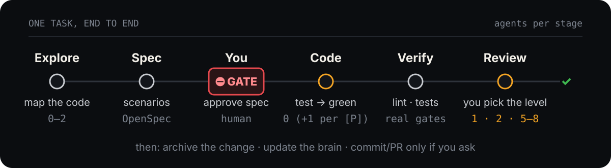

<p align="center">
  
</p>

A personal coding-agent setup for professional delivery on client projects: **one repo, symlinked into each tool** (Claude Code today, Codex next). The agent writes a spec, **waits for your OK**, codes test-first, gets reviewed by parallel agents and remembers each project, all without leaving a trace in the client's repo.

## Why

- **Vague requests become testable specs.** Every change is a list of `WHEN / THEN` scenarios before any code exists.
- **You stay in control.** Nothing is implemented until you approve the spec, and nothing is committed, pushed or merged unless you ask.
- **Reviews that catch real bugs.** Up to 8 specialist reviewers run in parallel, and Claude double-checks every serious finding.
- **No re-reading the repo every session.** A per-project *brain* maps what the project is, how it works and where things live.
- **Every client is different.** The project's own rules always win; this setup is only the default.

## How a task flows

<p align="center">
  
</p>

The code itself is written by the main Claude, which has the full context. Agents are used where an independent view helps: exploring, parallel `[P]` tasks and review.

## Daily use

| Say | What happens |
|---|---|
| `prepara este proyecto` | One-time setup: stack, specs location, brain, private config |
| `nuevo change: <idea>` | Explore → spec → **stops for your approval** |
| `implementa el change` | Task by task: failing test → code → green |
| `cierra el change` | Verify → review → archive → update the brain |
| `revisa la rama` | Review of the current branch at a level you choose |
| `lee cerebro` | Project memory: status and summary |

## What's inside

| | |
|---|---|
| 📐 **OpenSpec** | Spec-Driven Development: proposal, scenarios, design, tasks |
| 🤖 **14 agents** | Explorer, architect, TDD guide, build fixers and 8 reviewers |
| 🧠 **Brain** | `.agents/brain.md`: pointers only, freshness checked against git on every session start |
| 🧩 **Private overlay** | `AGENTS.local.md` + each tool's local settings, hidden through `.git/info/exclude` |
| 🛡️ **Safety rails** | Asks before any DB access (CLI or MCP) · blocks secrets, force-push and merges · auto-format |

```
core/              tool-neutral: AGENTS.md, skills, agents, rules
adapters/claude/   CLAUDE.md, settings (merged), hooks
install.sh         symlinks the repo into ~/.agents and ~/.claude
<project>/         team rules + conventions               ← always wins
<project>/         AGENTS.local.md · .agents/brain.md     ← private, never committed
```

## Rebuild it anywhere

```bash
git clone https://github.com/Rober040992/custom-agentic-sdd-brain-environment.git ~/Desktop/custom-claude-env
cd ~/Desktop/custom-claude-env && ./install.sh --tools claude
```

Edit files in the repo; every tool sees the change. Full explanation and prerequisites in [`docs/rober-agentic-environment.md`](docs/rober-agentic-environment.md).

## Limits

- Brain freshness is tracked against git commits and uncommitted files, not editor buffers.
- DB protection is pattern-based: custom scripts with unusual names rely on the written rule, not on a hard block.
- Built for a TypeScript / React / Node default stack; other stacks use the project's own rules.
- Codex adapter is in progress: hooks and subagents differ per tool, so some rails are written rules there instead of hard blocks.

---

<sub>Built on [OpenSpec](https://github.com/Fission-AI/OpenSpec) · curated parts of [ECC](https://github.com/affaan-m/ECC) · [Modern Web Guidance](https://github.com/googlechrome/modern-web-guidance) (opt-in) · README visuals made following [beautify-github-readme](https://github.com/oil-oil/beautify-github-readme)</sub>
