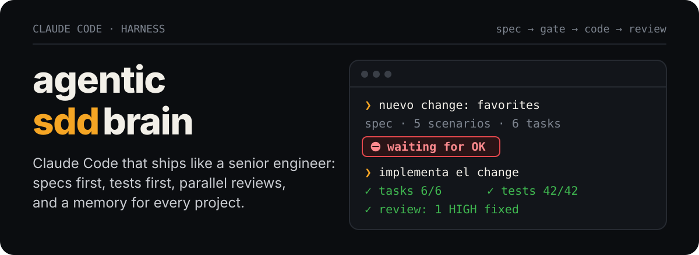

<p align="center">
  
</p>

**One repo that turns Claude Code, Codex and OpenCode into disciplined senior engineers.**

Before writing any code, the agent writes a spec and **waits for your OK**. Then it codes test-first, gets reviewed by specialist agents and keeps a small memory of each project. Nothing it creates ends up in your client's repo.

You install it once. From then on every tool reads the same rules, skills and agents from this repo.

## Why

- **Vague requests become testable specs.** Every change becomes a list of `WHEN / THEN` scenarios before any code exists.
- **You stay in control.** Nothing is implemented until you approve the spec. Nothing is committed, pushed or merged unless you ask.
- **Reviews that catch real bugs.** Up to 8 specialist reviewers run in parallel, and every serious finding is double-checked.
- **No re-reading the repo every session.** A per-project *brain* records what the project is, how it works and where things live.
- **Every client is different.** The project's own rules always win. This setup is only the default.
- **One source of truth.** Edit a rule or a skill once and every tool picks it up.

## Quick start

**1. Prerequisites:** `git`, `jq`, `python3`, Node.js ≥ 20.19, and at least one of `claude`, `codex` or `opencode`.

**2. Install OpenSpec and its skills** (one time):

```bash
npm i -g @fission-ai/openspec@latest
mkdir -p /tmp/os && cd /tmp/os && git init -q \
  && openspec init --tools claude --scope global --no-animation . \
  && cd - && rm -rf /tmp/os
```

The skills land in `~/.agents/skills`, a folder all three tools read.

**3. Clone and install:**

```bash
git clone https://github.com/Rober040992/custom-agentic-sdd-brain-environment.git
cd custom-agentic-sdd-brain-environment
./install.sh
```

The installer detects which tools you have, links this repo into each one and asks three questions:

```
Hooks (Enter = yes):
  Block edits to .env / keys / credentials? [Y/n]
  Format edited files (prettier > biome > eslint)? [Y/n]
  Check the project brain at session start? [Y/n]
```

**4. Restart your tools.** In Codex, run `/hooks` once and trust the new hooks.

**5. In each project, type `setup` once.**

> Keep the clone where it is: the tools read it through symlinks. If you move it, run `./install.sh` again.

## Daily use

Type one word. A normal day goes `setup` → `spec` → `build` → `ship`.

| Type | What happens |
|---|---|
| `setup` | One-time setup: detects the stack, asks where specs live, creates the private notes and the brain |
| `spec <idea>` | Explore → write the spec → **stop and wait for your approval** |
| `build` | Task by task: failing test → code → green |
| `ship` | Real checks (types, lint, tests, build) → review → archive → update the brain |
| `review` | Reviews the current branch with 1, 2 or 5–8 agents, chosen with you |
| `brain` | Shows the project memory and whether it is up to date |

Typos, formatting and pure refactors don't need a spec: just ask.

## How a task flows

<p align="center">
  
</p>

The main agent writes the code itself, because it holds the full context. Extra agents are used where an independent view helps: exploring, independent `[P]` tasks and review.

## What's inside

| | |
|---|---|
| 📐 **Spec-Driven Development** | [OpenSpec](https://github.com/Fission-AI/OpenSpec): proposal, scenarios, design, tasks. The `sdd` skill runs the whole cycle |
| 🧩 **21 skills** | 4 of our own (`sdd`, `delivery-review`, `project-setup`, `cerebro`) + 17 patterns: TypeScript, React, Next.js, NestJS, Prisma, Postgres, TDD, security… |
| 🤖 **14 agents** | Explorer, architect, TDD guide, build fixers and 8 reviewers (code, security, silent failures, tests, TypeScript, React, database, cleanup) |
| 🧠 **Brain** | `.agents/brain.md` in each project: a map of pointers only, checked against git |
| 🛡️ **Safety rails** | Asks before any database access · never force-pushes or merges · blocks secret files · formats edited code |

## How it works

This repo is the single source of truth. `install.sh` does not copy files. It creates **links** from each tool's folder to the repo:

```
this repo                              each tool reads it from
─────────                              ───────────────────────
core/AGENTS.md      global rules   →   ~/.claude (via CLAUDE.md) · ~/.codex · ~/.config/opencode
core/skills/        21 skills      →   ~/.agents/skills (Codex, OpenCode) · ~/.claude/skills
core/agents/        14 agents      →   ~/.claude/agents · generated for Codex (.toml) and OpenCode (.md)
core/hooks/         3 hooks        →   ~/.agents/hooks, registered in each tool
core/rules/         TS/React rules →   ~/.claude/rules
adapters/<tool>/    what only one tool needs (permissions, plugin, Claude's CLAUDE.md)
```

What each tool gets:

| | Claude Code | Codex | OpenCode |
|---|---|---|---|
| Global rules | ✓ | ✓ | ✓ |
| Skills | ✓ | ✓ | ✓ |
| Agents | ✓ | ✓ generated | ✓ generated |
| Ask before DB access | permissions | rules | permissions |
| Block force-push / merge | ✓ | ✓ | ✓ |
| Block secret files | hook | hook | plugin + permissions |
| Format on edit | hook | hook | plugin |
| Brain check at start | hook | hook | on demand (`brain`) |

Files that tools or other apps also write (`~/.claude/settings.json`, `~/.codex/hooks.json`, `opencode.jsonc`) are **merged**, never replaced. Anything replaced is backed up to `~/.agents/backups/<date>/`.

## Inside a client project

`setup` creates private files and hides them with `.git/info/exclude`, so the client's repo and its `.gitignore` are untouched:

```
<project>/
├── AGENTS.local.md               your notes: stack, commands, constraints, DB, where specs live
├── .agents/brain.md              the brain
├── CLAUDE.local.md               Claude only: imports the two files above
└── .claude/settings.local.json   Claude only: project permissions (DB servers → ask)
```

Specs live in the repo's `openspec/` folder if the team accepts it, or in a private store at `~/openspec-stores/<project>/`.

Precedence: **the project's own rules > `AGENTS.local.md` > global `AGENTS.md`**.

## Changing things

| I want to… | Do this |
|---|---|
| Change a rule or a skill | Edit it in the repo. Every tool sees it in the next session |
| Change an agent | Edit `core/agents/<name>.md`, then run `./install.sh` (Codex and OpenCode use generated copies) |
| Add a new skill or agent | Add it under `core/`, then run `./install.sh` to link it |
| Turn hooks on or off | `./install.sh hooks` |
| Get updates on another machine | `git pull`, then `./install.sh` |
| Preview changes | `./install.sh --dry-run` |
| Install without questions | `./install.sh --hooks all` (or `none`, or e.g. `secrets,format`) |
| Install only some tools | `./install.sh --tools claude,codex` |

## Limits

- **The brain** is compared against git commits and uncommitted files, not against unsaved editor buffers.
- **Database protection** works by matching command patterns. A custom script with an unusual name is covered only by the written rule, not by a hard block.
- **The default stack** is TypeScript / React / Node. Other stacks follow the project's own rules.
- **Codex** asks you to trust new or changed hooks once (`/hooks`). **OpenCode** has no session-start event, so it checks the brain only when you ask.
- **Tested on macOS.** Linux should work, but it hasn't been tested. Windows is not supported.

## Docs

[`docs/rober-agentic-environment.md`](docs/rober-agentic-environment.md) is the full guide. It explains each layer, which agents run at each step and how the brain works, and gives the rebuild steps. You can hand it to any coding agent as a single prompt.

---

<sub>Built on [OpenSpec](https://github.com/Fission-AI/OpenSpec) · curated parts of [ECC](https://github.com/affaan-m/ECC) · [Modern Web Guidance](https://github.com/googlechrome/modern-web-guidance) (opt-in per project) · README visuals made following [beautify-github-readme](https://github.com/oil-oil/beautify-github-readme)</sub>
